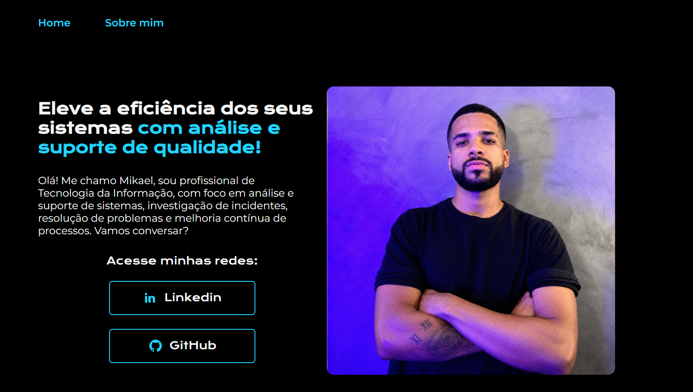

# Sobre Mim
Um portfólio onde armazeno informações sobre o meu trabalho como desenvolvedor e Analista, com informações adicionais sobre a minha carreira profissional. 

## Tecnologias utilizadas
 HTML  
 CSS  
 
## Tela inicial do portfólio

## Link do portfólio

https://sobre-mim-three.vercel.app/
